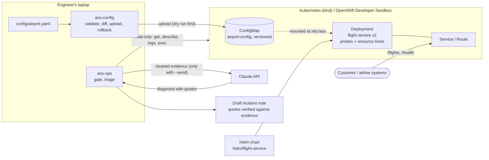

# AOS Commissioning Kit

A hands-on project that practises the work of an implementation engineer: deploy, configure and
troubleshoot a small **Airport Operational System (AOS)** on Kubernetes and Red Hat OpenShift, check
that it is ready for go-live, and diagnose faults from logs and events.

The system is deliberately small (one flight service) so the focus stays on the engineering around it:
packaging, configuration, readiness checks, incident diagnosis and documentation.

## The problem

Putting a customer's operational system into production fails in predictable ways:

| Problem | How it shows up | What this project does about it |
|---|---|---|
| Bad customer data is found late | A flight is assigned to a gate that does not exist; duplicate ids; a gate that belongs to no terminal | `aos-config validate` checks the airport file by field and cross rules **before** it reaches a cluster, and `diff` shows the change by meaning |
| "Is it ready for go-live?" is a feeling, not a result | Different engineers check different things | `aos-ops gate` runs the same checklist every time and returns an exit code, so a pipeline can use it |
| Config changes cannot be undone | A wrong upload leaves the system in an unknown state | Every upload is a numbered ConfigMap version; `rollback` restores an older one. Dry run is the default |
| Diagnosis is slow and inconsistent | Engineers jump to a guess, or collect different evidence each time | One method (look, why, application, connection, think, verify), six reproduced faults with notes, and `aos-ops triage` that collects the same evidence every time |
| Operations tools are dangerous | Wrong cluster or namespace, an accidental delete | The target is printed first, a namespace is always required, and `aos-ops` refuses every kubectl verb except `get`, `describe`, `logs` and `exec` |
| Knowledge stays in one person's head | The next engineer starts from zero | Each fault ends in an incident note: evidence, root cause, fix, who to escalate to, how to prevent it |

## Who uses it, and for what

The user is an **implementation (forward deployed) engineer** who brings a customer's system into
production and then supports it, and the **on-call engineer** who is paged when it breaks.

1. **Before go-live:** validate the customer's airport file, upload it as a versioned config, deploy the service with Helm.
2. **At go-live:** run the readiness gate. A failed criterion names the reason (for example `CrashLoopBackOff`, a Service selector that matches no pod, or a missing ConfigMap).
3. **When something breaks:** follow the playbook, or run `triage` to collect the evidence, get an AI-drafted diagnosis whose quotes are checked against the evidence, then verify it and file the incident note.
4. **After the incident:** change the config with a dry run first, and roll back if it was wrong.

## Architecture



Two flows matter. The **change flow** goes left to right: a config file is validated, uploaded as a new
version and mounted into the pods, and the service checks every gate against it. The **diagnosis flow**
only reads from the cluster and only leaves the laptop when `--send` is given.

## What is in the repo

| Path | What it is |
|---|---|
| `services/flight` | FastAPI flight service: list, create and update flights; checks gates against the mounted airport config (422 on a gate the airport does not allow); `/health` endpoint. Dockerfile and tests. |
| `k8s/` | Plain Kubernetes Deployment and Service with probes and resource limits. |
| `helm/flight-service` | Helm chart (`values.yaml` for kind, `values-openshift.yaml` with a Route for OpenShift). |
| `config/airport.yaml` | The "customer data" for a fictional airport: terminals, gates, carousels, airlines. |
| `tools/aos-config` | Python CLI that validates the config by field and cross rules, shows a semantic diff, uploads it as a versioned ConfigMap (dry run by default) and rolls back. [README](tools/aos-config/README.md) |
| `tools/aos-ops` | Read-only readiness gate, evidence collection with secret removal, and AI triage that drafts an incident note. [README](tools/aos-ops/README.md) |
| `docs/incidents` | Six faults reproduced on purpose and diagnosed with commands only, plus a playbook. [Playbook](docs/incidents/README.md) |
| `docs/presentation.html` | Slide deck that walks through the project. |

## Quick start (local)

Requirements: Docker, kind, kubectl, Helm, Python 3.

```bash
kind create cluster --name aos-dev
kubectl get nodes                                    # STATUS must be Ready

# 1. Build the image and load it into the cluster
docker build -t flight-service:0.2 services/flight
kind load docker-image flight-service:0.2 --name aos-dev

# 2. Upload the airport config first: the chart mounts the ConfigMap airport-config,
#    and the pods stay in ContainerCreating without it (see docs/incidents/06)
cd tools/aos-config
python3 -m venv .venv && source .venv/bin/activate && pip install -r requirements.txt
python -m aosconfig validate ../../config/airport.yaml
python -m aosconfig upload ../../config/airport.yaml -n default --apply
cd ../..

# 3. Install the chart and check readiness
helm install flight helm/flight-service
cd tools/aos-ops
python3 -m venv .venv && source .venv/bin/activate && pip install -r requirements.txt
python -m aosops gate -n default
```

## Phases

| Phase | Result |
|---|---|
| 0. Environment | docker, kind, kubectl, helm, oc |
| 1. Flight service | FastAPI service and container image |
| 2. Kubernetes and Helm | Manifests with probes and limits; Helm chart; upgrade and rollback practised |
| 3. OpenShift | Deployed to the Red Hat Developer Sandbox with a Route and an OpenShift values file |
| 4. Config tool | `aos-config` with rules, diff, versions and rollback; the service validates gates from the live config |
| 5. Broken deployments | Six faults diagnosed from evidence; incident notes and a playbook |
| 6. Readiness and triage | `aos-ops gate` (fixed rules) and `aos-ops triage` (AI draft with quote verification) |
| 7. Documentation | This README, the per-tool READMEs and the incident playbook |

## Design choices worth knowing

- **Read-only operations tooling.** `aos-ops` refuses every kubectl verb except `get`, `describe`,
  `logs` and `exec`. Changes are suggested, never made.
- **Dry run first.** `aos-config` and `aos-ops triage` print the target and what would happen, and do
  nothing until `--apply` or `--send` is given.
- **AI is a draft, not an authority.** Evidence is cleaned of secrets before it leaves the computer, the
  model must answer in a fixed shape with exact quotes, and every quote is checked against the evidence.
  A draft with an unverifiable quote is marked "do not trust".
- **Known limitation.** The flight service keeps its data in memory, so replicas do not share flights.
  This is kept on purpose to show why state must live outside the pod; a database is the next step.

## Technology set

The set covers two kinds of work: **designing** a solution (architecture, decisions, trade-offs) and
**running** it reliably (SRE). Each tool is here because it answers a specific question.

| Area | Tool | Question it answers | Status |
|---|---|---|---|
| Build | Python, FastAPI, Pydantic, Typer, pytest | How do I build the service and its tools, with tests? | In use |
| Package and run | Docker, Helm | How do I ship the same thing to every environment? | In use |
| Platform | Kubernetes (kind), Red Hat OpenShift Developer Sandbox | Where does it run, and what differs between them? | In use |
| Reliability checks | Readiness gate, incident playbook | Is it ready, and what do I do when it is not? | In use |
| AI-assisted diagnosis | Claude API with schema-checked answers | Can a model speed up triage without being trusted blindly? | In use |
| Automation | GitHub Actions | Do tests, `helm lint` and the image build run on every push? | Planned |
| Observability | Prometheus and Grafana | What do the service's metrics say, and what are its SLIs? | Planned |
| Reliability targets | SLIs, SLOs and an error budget | How reliable must it be, and when do we stop shipping? | Planned |
| Architecture | ADRs and C4 diagrams in `docs/architecture` | Why was each choice made, and what was the alternative? | Planned |
| State | PostgreSQL | How do replicas share data? (fixes the known limitation) | Planned |
| Supply chain | Trivy image scan | Does the image ship known vulnerabilities? | Planned |

## Roadmap

Work is split into small pieces, each one issue with a clear "done" test, tracked on the
repository's GitHub Project board. Planned order:

1. CI with GitHub Actions: tests, `helm lint`, image build.
2. PostgreSQL for flight data, so replicas share state.
3. `/metrics` endpoint, Prometheus and a Grafana dashboard.
4. Two SLOs with alerts, and a short burn-rate runbook.
5. ADRs and C4 diagrams for the decisions above.
6. Image scan in CI.

## Tests

```bash
cd services/flight   && python -m pytest
cd tools/aos-config  && python -m pytest
cd tools/aos-ops     && python -m pytest
```
