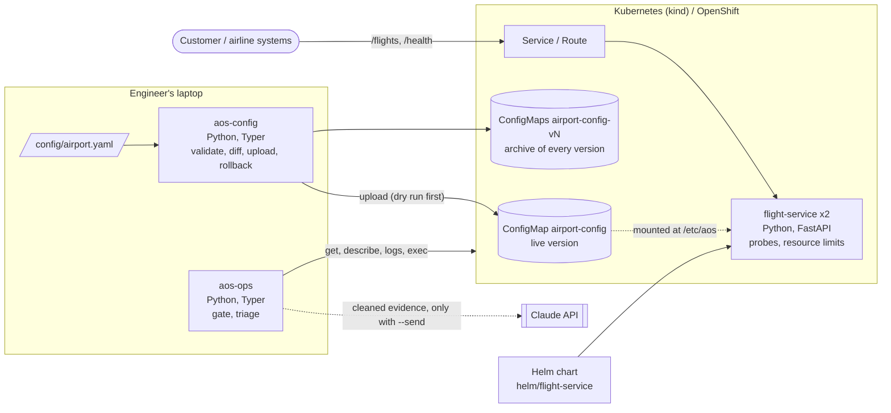

# C4 level 2: containers

What runs on the engineer's laptop and what runs in the cluster.

## Containers

| Container | Technology | Responsibility |
|---|---|---|
| `aos-config` | Python, Typer, Pydantic | Checks the airport file by field and cross rules, shows a semantic diff, uploads a numbered version, rolls back. Dry run by default. |
| `aos-ops` | Python, Typer | Read-only readiness gate; collects evidence, removes secrets, asks for a diagnosis draft and verifies its quotes. |
| `flight-service` | Python, FastAPI, Docker | Lists, creates and updates flights; rejects a gate the airport config does not allow (HTTP 422). Keeps data in memory. |
| `airport-config` | ConfigMap | The live airport file the service reads at `/etc/aos/airport.yaml`. |
| `airport-config-vN` | ConfigMaps | One archive copy per uploaded version, never deleted. |
| Helm chart | Helm | Deployment, Service and (OpenShift only) Route, with values per environment. |

## Known limitation
The flight service keeps data in memory, so replicas do not share flights. A database is on the
roadmap (issue #2).
