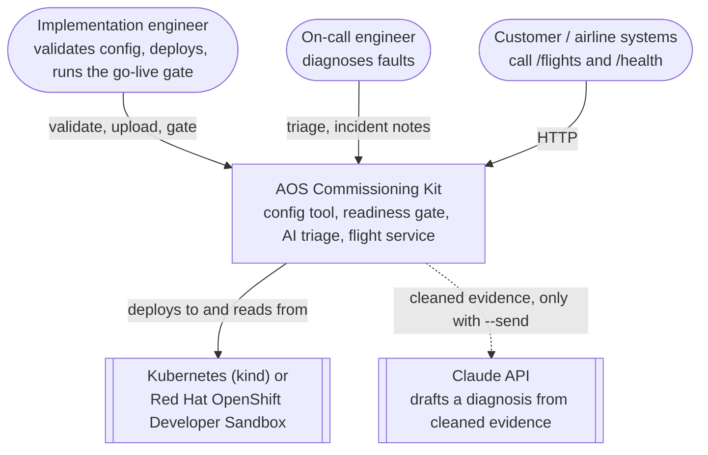

# C4 level 1: system context

The kit sits between an engineer and a Kubernetes or OpenShift cluster that runs the Airport
Operational System (AOS) flight service for a customer.

## Notes
- The dashed arrow is optional. Nothing leaves the engineer's computer unless `--send` is given
  ([ADR 0004](adr/0004-ai-triage-with-quote-verification.md)).
- The kit reads from the cluster with read-only commands
  ([ADR 0003](adr/0003-read-only-operations-tooling.md)).
